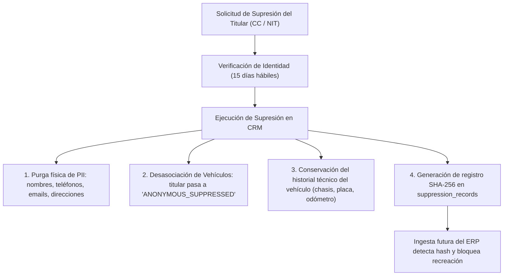

# MIA CRM — Checklist Legal, Protección de Datos y Privacidad (Ley 1581 / SIC)
**Hito M8: Preparación del Piloto de Concesionario**
*Documento de Cumplimiento Normativo para Colombia y Transferencia Internacional*

---

## 1. Marco Regulatorio Aplicable en Colombia

El despliegue de **MIA CRM** en concesionarios y talleres de Colombia está sujeto a:
- **Ley Estatutaria 1581 de 2012** (Régimen General de Protección de Datos Personales).
- **Decreto 1377 de 2013** (Reglamentación de autorización, políticas y transferencias).
- **Circular Externa 005 de 2017 de la Superintendencia de Industria y Comercio (SIC)** (Estándares de seguridad y países con nivel adecuado de protección).
- **Registro Nacional de Bases de Datos (RNBD)** administrado por la SIC.

---

## 2. Checklist de Verificación Pre-Piloto (Criterios de Salida M8)

| Ítem | Requisito Legal / Arquitectónico | Estado en MIA CRM | Referencia Técnica |
|---|---|:---:|---|
| **L-01** | **Base de Legitimación Contractual (Posventa):** La ingesta de clientes con vehículo activo para garantías y servicios preventivos se fundamenta en la relación contractual de compraventa y mantenimiento. | ✅ CUMPLIDO | Decisión **D-49**, tabla `consents` con `basis: 'contractual_relationship'`. |
| **L-02** | **Autorización Expresa para Marketing e IA:** Contactos proactivos comerciales, perfilamiento predictivo o renovación exigen consentimiento expreso e informado. | ✅ CUMPLIDO | Decisión **D-12**, el motor de oportunidades valida consentimientos activos antes del scoring. |
| **L-03** | **Derecho de Supresión (Habeas Data):** Cuando un titular ejerce su derecho al olvido, se eliminan físicamente sus datos personales sin alterar el historial técnico de seguridad del vehículo. | ✅ CUMPLIDO | Decisión **D-31**, desasociación a titular anónimo `SUPPRESSED` y purga de PII. |
| **L-04** | **Mecanismo Antirreingreso:** Previene que la ingesta recurrente del ERP vuelva a crear a una persona que solicitó su supresión. | ✅ CUMPLIDO | Decisión **D-32**, tabla `suppression_records` con hash criptográfico SHA-256 salted. |
| **L-05** | **Minimización de Datos en Ingesta ERP:** Exclusión estricta de datos sensibles (estado civil, estrato socioeconómico, orientación, datos crediticios). | ✅ CUMPLIDO | Decisión **D-48**, lista blanca en adaptador y tabla `terceros`. |
| **L-06** | **Transferencia Internacional de Datos:** Infraestructura en EE.UU. Este (PostgreSQL, Redis, RabbitMQ y APIs de LLM). | ✅ CUMPLIDO | Decisión **D-34**, declaración en la Política de Tratamiento del Concesionario. |
| **L-07** | **Zero Data Retention (ZDR) en IA:** Los proveedores de modelos de lenguaje no almacenan ni entrenan con datos del CRM. | ✅ CUMPLIDO | Decisión **D-24**, contratos DPA empresariales y minimización de prompts. |
| **L-08** | **Término Legal de Respuesta a Solicitudes:** Plazo máximo de 15 días hábiles para resolver reclamos y supresiones de titulares. | ✅ CUMPLIDO | Flujo documentado en la sección 4 de este documento. |

---

## 3. Arquitectura de Supresión y Antirreingreso (Decisiones D-31 y D-32)

---

## 4. Procedimiento Operativo para Atención de Peticiones y Reclamos (PQR)

1. **Recepción:** El titular radica su solicitud por correo electrónico oficial o canal de atención al cliente del concesionario.
2. **Plazo de Atención:**
   - **Consultas:** Máximo diez (10) días hábiles (prorrogables por 5 días adicionales con aviso justificado).
   - **Reclamos, Correcciones o Supresiones:** Máximo quince (15) días hábiles (prorrogables por 8 días adicionales con aviso justificado).
3. **Ejecución Técnica:**
   - El administrador del concesionario ejecuta el caso de uso `SuppressPartyUseCase` ingresando el documento y radicado.
   - Se genera la constancia digital con timestamp y se envía certificación al titular.

---

## 5. Acuerdos Requeridos antes del Despliegue en Producción

1. **Contrato de Transmisión de Datos:** Suscrito entre el concesionario (Responsable del Tratamiento) y MIA CRM SaaS (Encargado del Tratamiento).
2. **Actualización de la Política de Tratamiento de Información (PTI):** Inclusión de la finalidad de *asistencia inteligente mediante inteligencia artificial para la retención y mantenimiento de vehículos*.
3. **Registro en el RNBD:** Actualización de los canales y encargados ante el Registro Nacional de Bases de Datos de la SIC.
